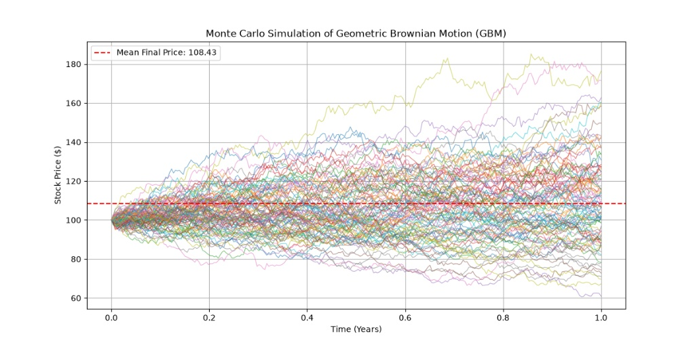

# Monte Carlo Simulation of Geometric Brownian Motion (GBM)

This project implements a Monte Carlo simulation of **Geometric Brownian Motion (GBM)** in Python to model stock price dynamics over a specified time horizon. GBM is widely used in financial engineering and quantitative finance—most notably as the underlying stochastic process for the Black-Scholes-Merton option pricing model.

---

## Mathematical Formulation

The evolution of a stock price $S_t$ under Geometric Brownian Motion is governed by the stochastic differential equation (SDE):

$$dS_t = \mu S_t dt + \sigma S_t dW_t$$

Where:
* $S_t$ is the stock price at time $t$.
* $\mu$ is the annualized expected return (drift).
* $\sigma$ is the annualized volatility.
* $W_t$ is a standard Brownian motion (Wiener process).

Using Itô's lemma, the exact discrete-time solution for simulating future stock prices over a time step $\Delta t$ is given by:

$$S_{t + \Delta t} = S_t \exp\left(\left(\mu - \frac{1}{2}\sigma^2\right)\Delta t + \sigma \sqrt{\Delta t} Z\right)$$

Where $Z \sim \mathcal{N}(0, 1)$ represents standard normal random variables.

---

## Key Features

* **Vectorized Simulation:** Simulates thousands of independent price paths (M = 10,000) concurrently across daily time steps (N = 252 trading days) using NumPy for high computational efficiency.
* **Statistical Analysis:** Automatically computes and prints descriptive statistics (mean final price and standard deviation) at the terminal horizon $T$.
* **Visualization:** Plots a representative subset of simulated trajectories alongside an analytical reference line for the mean final price using Matplotlib.

---
## Simulation Parameters & Setup

* **Initial Stock Price:** $100.00
* **Annualized Expected Return:** $8.0\%$ ($0.08)
* **Annualized Volatility:** $20.0\%$ ($0.20)
* **Time Horizon:** $1.0$ Year
* **Time Steps:** $252$ trading days 
* **Simulated Paths:** $10,000$ independent trajectories
---

---
## Key Findings & Terminal Statistics

**Based on the executed simulation run:**

* **Mean Final Price:** **$108.43** at $T = 1.0$ year, reflecting the expected upward drift of the asset over the annual cycle.
* **Standard Deviation:** **$22.14**, capturing the dispersion of terminal prices driven by underlying volatility.
* **Price Range & Dispersion:** Due to the $20\%$ volatility parameter, individual paths exhibit wide dispersion at the terminal horizon, ranging from approximately $\$60.00$ on the lower bound to over $\$180.00$ on the upper bound.
* **Drift Baseline:** The red dashed horizontal reference line highlights the deterministic mean final price across all paths, serving as a visual benchmark against individual stochastic realizations.